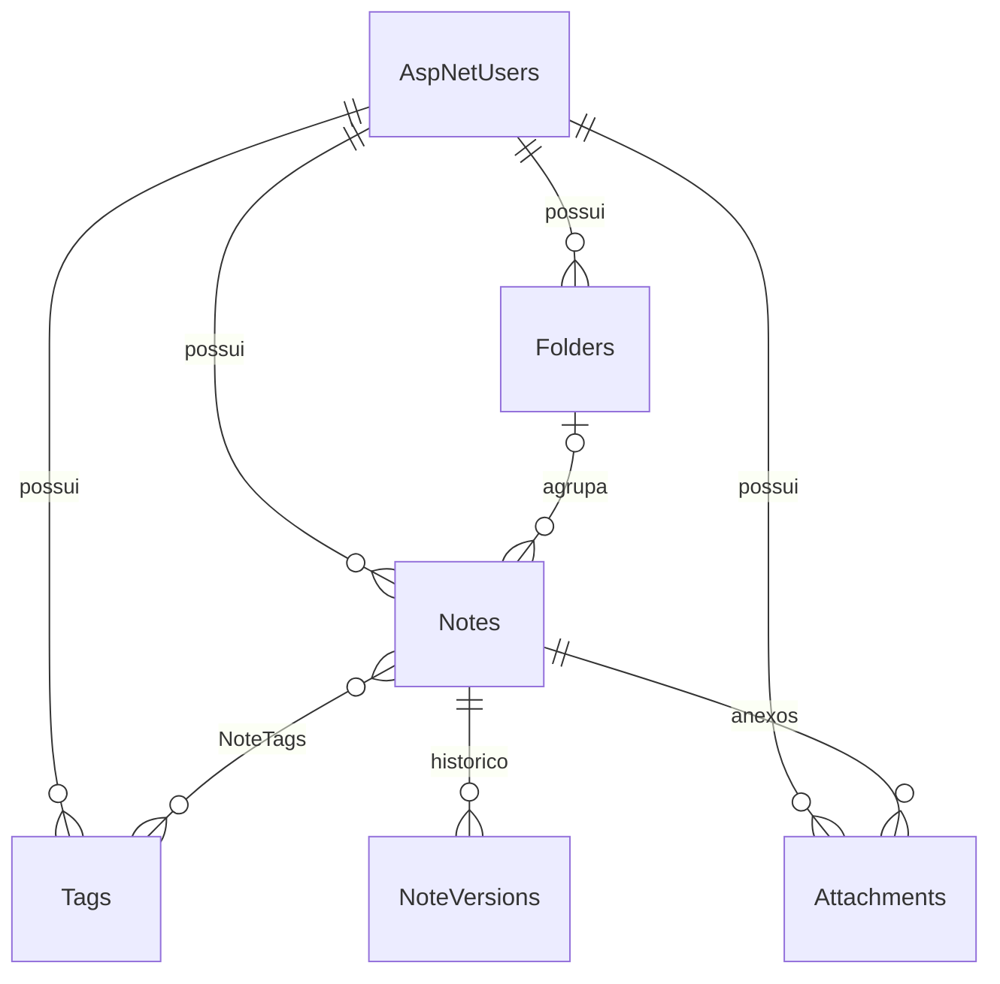

# Notas — sistema de anotações em C# (.NET 10)

App de anotações multiusuário, com foco em escrita fluida, organização e privacidade.
Backend e frontend 100% em C#: **ASP.NET Core + Blazor Web App + EF Core + PostgreSQL + ASP.NET Identity**.

> **Estado honesto do projeto:** o código foi escrito com cuidado, mas **ainda não foi compilado nem executado**
> (o ambiente onde foi gerado não tem o SDK do .NET nem acesso ao NuGet). Espere pequenos ajustes de compilação
> na primeira vez. Veja a seção 10 para a ordem recomendada de validação.

---

## 1. Resumo da stack

| Camada | Escolha | Por quê |
|---|---|---|
| Runtime | **.NET 10 (LTS)** | .NET 8 sai de suporte em nov/2026; 10 é o LTS atual. |
| UI | **Blazor Web App** (SSR estático + Interactive Server) | Um único idioma/modelo mental; editor com autosave e latência baixa via SignalR; telas de auth em SSR puro (cookies + antiforgery nativos, sem JS de token). |
| Backend | ASP.NET Core minimal APIs (`/api/v1`) para binários (anexos, export) | Blazor Server fala direto com serviços de aplicação; a API cobre o que precisa de HTTP puro (imagens em ``, download). |
| ORM / BD | **EF Core + PostgreSQL (Npgsql)** | Robusto, full-text search nativo (`tsvector` + GIN, config `portuguese`), `ExecuteUpdate/Delete` eficientes. |
| Auth | **ASP.NET Core Identity** (cookie) | Hash de senha (PBKDF2), lockout, tokens de reset, security stamp. |
| Markdown | **Markdig** + **HtmlSanitizer** | HTML cru desabilitado *e* saída sanitizada (defesa em profundidade contra XSS). |

**Editor:** abordagem **Markdown com pré-visualização** (Escrever / Dividido / Ler), barra de formatação e atalhos.
Texto puro é portável, versionável por diff, leve para busca e imune a HTML malicioso armazenado — melhor custo/benefício que rich text para um app de notas.

## 2. Arquitetura

```
Notas.Web  (Blazor, endpoints, Identity UI, segurança HTTP)
   └─> Notas.Infrastructure  (EF Core, serviços de aplicação, storage, jobs)
          └─> Notas.Core  (entidades, DTOs, contratos, Result, regras puras)
```

- **Core** não depende de nada (nem EF). Contratos (`INoteService`...) vivem aqui.
- **Infrastructure** implementa os serviços direto sobre o `DbContext`. Não há camada de repositório genérica
  de propósito: o EF Core já é Unit of Work + Repository, e o repositório só adicionaria indireção e perderia
  `ExecuteUpdate`, projeções e `Include` tipados.
- **`IDbContextFactory`** em vez de `DbContext` escopado: em Blazor Server o escopo dura o circuito inteiro
  (horas); um contexto longo acumula estado e causa concorrência. Cada operação abre um contexto curto.
- **Result<T>** em vez de exceções para fluxo de negócio (NotFound/Validation/Conflict).
- **Concorrência otimista** (`Note.Revision`): duas abas editando a mesma nota não se sobrescrevem silenciosamente.
- **Soft delete** (lixeira) com purga automática em 30 dias (`TrashPurgeService`).

## 3. Estrutura de pastas

```
Notas.slnx
Directory.Build.props
docker-compose.yml                  # PostgreSQL local
src/
  Notas.Core/
    Entities/  Dtos/  Abstractions/  Common/
  Notas.Infrastructure/
    Data/      AppDbContext, AppUser, DesignTimeDbContextFactory  (+ Migrations/ após gerar)
    Services/  NoteService, FolderService, TagService, AttachmentService, TrashPurgeService
    Storage/   LocalFileStorage
  Notas.Web/
    Components/
      Layout/   BlankLayout, AccountLayout
      Account/  Login, Register, ForgotPassword, ResetPassword, Logout, Manage
      Pages/    Workspace (app principal), Error
      Shared/   Sidebar, NoteList, NoteEditor, TagInput, HistoryPanel, AttachmentsPanel,
                ConfirmDialog, Toasts, EmptyState, Icon
    Endpoints/  ApiEndpoints (/api/v1/attachments, /api/v1/export)
    Services/   CurrentUser, ToastService, ClientClock, MarkdownService, e-mail, erros Identity PT-BR
    wwwroot/    app.css, app.js, theme.js
tests/Notas.Tests/                  # xUnit + SQLite em memória
```

## 4. Modelo de dados



- `Notes`: Title(200), Content, FolderId?, IsPinned, IsFavorite, IsArchived, DeletedAt?, CreatedAt, UpdatedAt, **Revision** (token de concorrência), `SearchVector` (tsvector gerado, índice GIN).
- Índices: `(UserId, DeletedAt, UpdatedAt)`, `(UserId, FolderId)`, únicos `(UserId, Name)` em Folders e Tags.
- FKs para o usuário com **cascata** → excluir a conta apaga tudo no banco. Pasta excluída → `SET NULL` nas notas.
- `NoteVersions`: snapshot do estado *anterior* a cada edição (no máx. 1 a cada 10 min; mantém 30).

## 5. Backend

Serviços (todos filtram por `UserId` em **toda** consulta):

- `NoteService`: listagem paginada com filtros (visão, pasta, tag, intervalo de datas, busca), contadores, CRUD, ações
  (fixar/favoritar/arquivar/lixeira/restaurar via `ExecuteUpdate`, sem tocar `Revision`), histórico, exportação.
- **Busca (PostgreSQL):** título por `ILIKE` (digitação parcial) **ou** full-text `websearch_to_tsquery('portuguese')`
  (stemming: "reuniões" acha "reunião") **ou** tag. Em testes/SQLite há fallback portável.
- `FolderService`, `TagService`, `AttachmentService` (tipo por *magic bytes*, 5 MB, 20/nota, nome gerado no servidor).
- API versionada: `GET /api/v1/attachments/{id}`, `GET /api/v1/export` (JSON, portabilidade LGPD).

## 6. Frontend

- `Workspace.razor`: 3 painéis (navegação · lista · editor), orquestra estado, busca com debounce, paginação incremental,
  desfazer ao arquivar/excluir, confirmações.
- `NoteEditor.razor`: **autosave** com debounce de 900 ms, serializado por semáforo, indicador de estado
  (Salvo / Pendente / Salvando / Erro com "tentar de novo" / Conflito), aviso `beforeunload` com alterações pendentes,
  pré-visualização Markdown, anexos, histórico e restauração de versões.
- Estados: *skeleton* de carregamento, vazio específico por visão, erro com retry.

## 7. UI/UX

- Tokens CSS (claro/escuro, sem *flash* de tema — `theme.js` roda no `<head>`), respeita `prefers-color-scheme`.
- Tipografia: UI sans-serif de sistema/Inter; **serifa** (Source Serif/Georgia) para escrita e leitura.
- Responsivo: desktop 3 colunas; tablet com sidebar em gaveta; celular em pilha com editor deslizante.
- Acessibilidade: *skip link*, foco visível, `aria-label/pressed/current`, regiões `aria-live` (salvar, toasts),
  `role="alertdialog"` com foco inicial, `prefers-reduced-motion`.
- Atalhos: `Ctrl+K` busca, `Ctrl+B/I` formatação.
- *Fonte Inter:* para self-hosting, coloque os `.woff2` em `wwwroot/fonts` e declare `@font-face` (a CSP só permite `'self'`).

## 8. Segurança

| Risco | Mitigação |
|---|---|
| Acesso a dados de outro usuário (IDOR) | Todo acesso filtra por `UserId`; 404 (não 403) para itens alheios; testes dedicados. |
| XSS | Markdig com HTML desabilitado + HtmlSanitizer; CSP restritiva (`script-src 'self'`); anexos nunca renderizados inline (exceto imagens validadas), `nosniff`, `sandbox`. |
| CSRF | Antiforgery em todos os formulários (SSR); cookie `SameSite=Lax`; logout via POST. |
| Força bruta | Lockout (5 tentativas/15 min) + rate limit (10 POST/min/IP em `/account`). |
| Enumeração de contas | Mensagens idênticas no login e na recuperação de senha. |
| Open redirect | `returnUrl` aceita apenas caminhos locais. |
| Upload malicioso | Tipo por conteúdo, SVG/HTML recusados, tamanho limitado, caminho gerado (anti *path traversal*). |
| Sessão | Cookie `HttpOnly`/`Secure`, expiração deslizante, troca de senha invalida outras sessões. |
| Segredos | Conexão fora do `appsettings.json` (user-secrets/variável de ambiente). |

Pendente para produção: confirmação de e-mail com provedor real, 2FA, chaves do Data Protection persistentes
(`DataProtection:KeysPath`), HTTPS/HSTS no proxy.

## 9. Testes

`tests/Notas.Tests` (xUnit, SQLite em memória com FKs ativas): isolamento entre usuários (listar/ler/editar/excluir/pasta alheia),
conflito de revisão, normalização e limites de tags, lixeira/restauração, fixadas/favoritas/arquivo + contadores,
busca (título/conteúdo/tag), filtros, versionamento + restauração, exclusão permanente, pasta excluída, unicidade de nomes.
Sugestão futura: testes de integração com Testcontainers (PostgreSQL real) e bUnit para o editor.

## 10. Como rodar

Pré-requisitos: **.NET 10 SDK**, **Docker** (ou um PostgreSQL 15+).

```bash
docker compose up -d                  # PostgreSQL em localhost:5432
dotnet test                           # valida regras de negócio
dotnet run --project src/Notas.Web    # aplica migrations incluídas automaticamente em Development
```

Abra `https://localhost:7180`, crie uma conta e escreva. Links de recuperação de senha aparecem **no log** em Development.

Ordem recomendada na primeira execução: `dotnet build` → `dotnet test` → `dotnet run`.

Produção: defina `ConnectionStrings__Default`, `Storage__RootPath` (volume persistente), `DataProtection__KeysPath`,
`ReverseProxy__Enabled=true` (atrás de proxy), e substitua `LoggingEmailSender` por um provedor real.

## 11. Melhorias futuras

2FA (TOTP) e confirmação de e-mail · compartilhamento/colaboração e links públicos · busca com destaque (`ts_headline`) ·
Dockerfile + CI · storage S3/Azure Blob · notas fixadas por pasta e ordenação manual · editor WYSIWYG opcional (Tiptap)
· PWA/offline · importação (Markdown/Evernote/Notion) · exportação ZIP com anexos · lembretes · tema por usuário persistido no servidor
· OpenTelemetry + health checks detalhados · testes E2E (Playwright).
